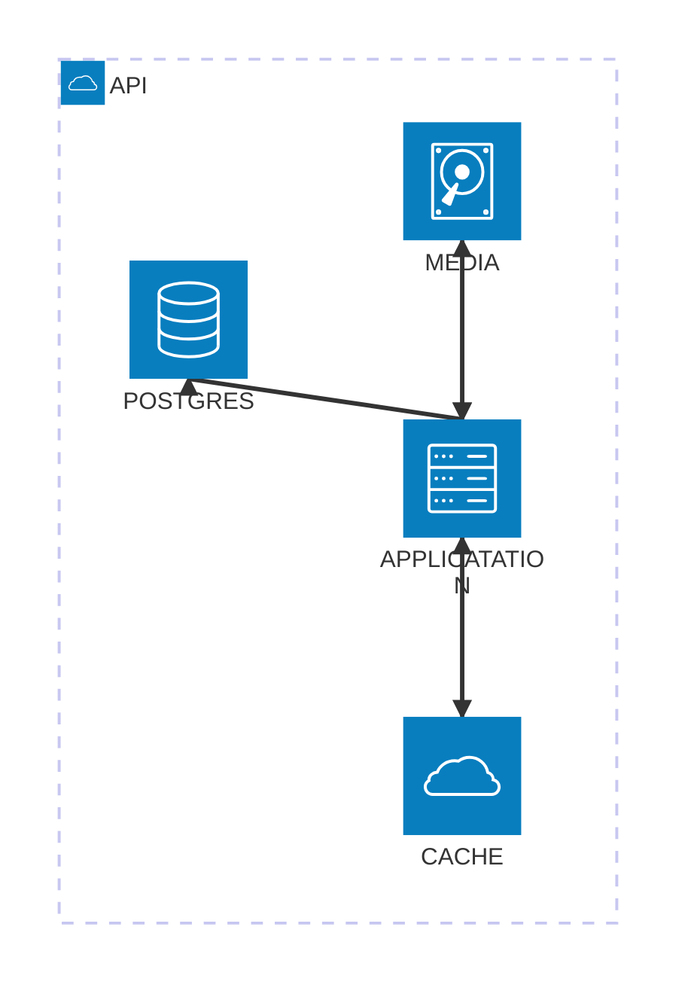

# Web Journal

Web Journal is a site for sharing stories and experiences using a variety of elements, such as: photos, videos, text, maps, and weather. The goal is to have an easy to use editor that allows user to assemble their story into an engaging and asthetically pleasing page.

The project is separated into two main parts: the backend web api, responsible for managing data, and the frontend app for users to interact with.

## Requirements

- a page/story editor that allows dragging and dropping elements onto a canvas that controls layout and editing their attributes.
- make pages easily themeable: colors, typography, etc.
- an index of stories for each user
- stories should have different access levels: public, anonymous link, password protected
- some elements, like photos and videos and maybe maps should be expandable to view a full size version -- it would be great to do that inline, but a lightbox would do too
- especially since I'm not doing this to make money, the published pages should have minimal branding or extra UI. Basically just some bread crumbs starting from user's index and a small monochrome logo at the top, and a powered by string at the bottom. These should take the page's theme colors.
- editor and site ui should be fairly minimal and respond to device's dark mode setting

### Users
- users are able to register on the site using a one time code provided by an existing admin user. This is to control who has access to my side project.
- users can login to the site using an email and password.
- 
### User Pages

This is the main feature of this app. They should be fast to load, not too heavy on resources, and responsive to different screens.
- pages need to be cached to avoid having to rerender them on every request.
- use responsive photo sizes and effecient formats for each browser (webp, heic, etc.)
- should include a full size viewer for photos on the page that allows swiping between pictures in the order they appear on the page.
- should be optionally password protected so users can control who can see their pages.
- should be themeable
- site branding should be understated on published pages: just a small icon at the top and a powered-by line at the bottom

### User Gallery

- users have a gallery of their published pages
- this gallery is optionally password protected
- users can set some options for this gallery:
  - a color scheme for this gallery
  - title
  - avatar
  - header photo

### Editor
- user should be able to view all of their pages in a paginated grid of thumbnail cards.
- the user should be able to delete pages from the browser
- the user can edit a page by clicking the edit button on the card in the browser. This opens the editor for that page.
- needs to allow dragging and dropping elements of various types onto a canvas to build the page.
- should group elements into rows with 1-4 elements each.
- elements should take up all availble space in a row
- when a user drops an element at the bottom of the page, create a new row and add the element to it.
- when a user drops an element onto an existing row, the element should be added to the row at it's drop point. If the row is full, the last element in the row should be moved to a new row. The dropped element should be placed at it's drop point in the existing row.
- specifics of how adding elements to page will probably change as I play with it.
- it should auto save changes to the page as the user makes them.
- it should keep a history of changes a user makes.
- it should have a button to publish changes when the user is ready.
- users can select a color scheme for their page that will apply styling consistently across all parts of the page to give them a unique look and feel.

## Architecture

### Overview

This project is largely a place for me to experiment with application architecutre, drawing on my experience from my job over the past 13 years and some ideas I've had while working but couldn't implement, and some other research I've done. It is built with a service layer that uses full featured models to provide the application's functionality and provides an interface for the REST API and some maintenance commands to use.

### Services

Services provide the bulk of the application's business logic and provide a well defined interface for interacting with the application.

### Models

Models follow the active record pattern, because my data model is simple amd mostly just doing CRUD operations. I didn't want the complexity of adding a mapping layer to this project. Sql queries are constant hard coded, hand optimized strings defined above the model methods that execute them. I've shied away from dynamic query builders because I've seen them lead to hard to optimize and anyalyze queries that can take down a production database. I've used sqlc in the past to generate go code from queries, but I didn't think it integrated well into this project. For one thing, it created extra models that I didn't want to use. So this project is using manually written row scanning code. It's a little repetetive, but not too complicated to write.

Still thinking about the best way of relating models to tables.

### Handlers

The REST api is defined in a series of handlers. They are strictly responsible for processing user input, calling a service, and returning a response.

### Challenges and Learning

- how to divide some functionality. Specifically validation. It makes sense for models to validate their own data, but I found it cumbersome to add it to the models. It also make sense that it would happen in the handlers and cli tools which directly take user input.
- model relationships. I like the idea of having one model per table. It seems obvious and clean. But then how do I pull related models efficiently?
  - Need to avoid cycles

### Application

Different ideas for this:
- Go backend with react frontend. 
  - Publish pages as static html files.
  - Or, whole site is a single page app.
- build with nextjs for more unified frontend and backend. Relying on Vercel's deployment architecture is too much vendor lock-in for me.

Going with the go backend because I can make a good solid webservice in go more easily in nextjs. Go is going to be faster than javascript.

Nextjs frontend for dynamic 

### Data Storage

Using Postgres for the database. It's good and reliable and I'm familiar with it. Plus it has some good JSON features that could be handy for handling element attributes.

For photos, it's probably best to use an S3 compatible object store. It scales well and I do have good experience with it.

Depending on how I store published pages, maybe need some sort of document store. Really just a key-value store with really big value. Redis/ValKey, ArangoDB

### Caching

Will need a caching layer to store rendered pages and also photos. Should these be separate caches? Probably.

The page cache will need to be able to invalidate a cached page when the user republishes it.

## Things to Think About

- Login & Signup Flow
  - don't want this to be generally available, so need to use single use code to allow registration
  - How hard would it be to support paskeys?
- Editing & Publishing workflow
  - Thinking about having an edit, save, publish workflow. Allows the user to spend some time working on a page before making it public. This would require saving the current editor state in the database and saving the published result somewhere. Probably a document store described in [Data Storage](###data-torage).

### Layout

I'm looking for a good way to layout elements on the page in a way that will be user friendly and look good on published pages. It needs to work with a simple drag and drop editor that allows users to choose where to place elements relative to other elements on the page. The layout also needs to be responsive to different screen sizes. It shouldn't rely on javascript for layout on published pages.

My initial vision of this is that user's would drop elements anywhere into a grid on the page. The editor would rearrange existing elements around the new one.

- CSS grid. Would allow the user to place the elements exactly where they want them. It's tricky to make this responsive though. Each element would be assigned coordinates to place it on the grid. Unless I could find a way to generate different coordinates for different breakpoints.
  - Switching to a single column of elements on mobile would be able to take care of that.
- Inline block elements. Would allow elements to flow naturally on any screen, but elements of different heights would look disjointed.
- Predfined block level elements that the user can customize. Easy to control layout, but not flexible at all.
- Flexbox containers. Can hold elements and control horizontal layouts. Each element could only be on one row. The containers would control responsive layout. This might be the best compromise of flexibility and controllability. The biggest downside I see is that it would add complexity to the editor and data storage. Need multiple levels of elements on the page. I think that's manageable though. Is there a way I could automate this? Have discrete rows and allow the user to add as many elements to a row as they want (maybe cap it like 8 or something?) and resize them (maybe guided by snap points) and save flex info to the element. Then each flex row could ajdust itself for different screen sizes. Just need to make sure that the editor UI makes it clear how it works. If it needs a complicated tutorial, then it's not a good design.
  - AI assisted mockup of this layout collapses to one item per row on mobile, which actually looks pretty good. The layout on table, with between two and four elements per row looks a bit messy. I might be able to clean that up by foring elements to expand vertically to fill their row. But that might be too restrictive. Also, the AI generated arrangement is a little odd. I don't know if I'd arrange things this way if I was building the page myself as a user. It might look better if it's hand done.

### Storing Element Types

For each element type, I need to know how to render them when they're dropped onto the canvas and when they're displayed on a published page. I'd really rather not store HTML in a database or anything like that, especially since I'll be using react.

I think I do want to store a list of element types in the database with their different attributes.

The most obvious solution to me is
