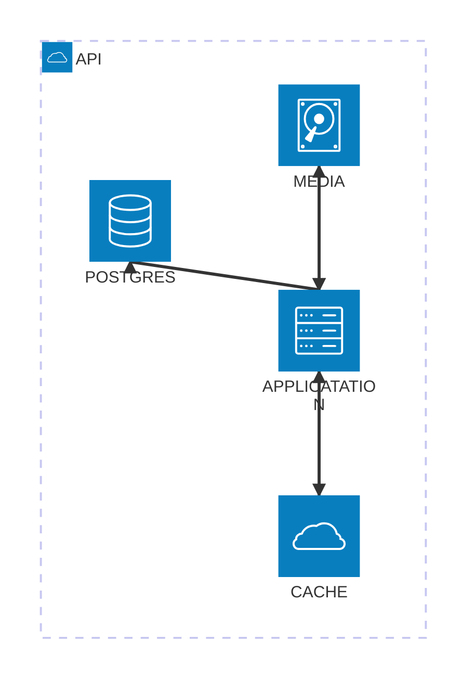

# Web Journal

Web Journal is a site for sharing stories and experiences using a variety of elements, such as: photos, videos, text, maps, and weather. The goal is to have an easy to use editor that allows user to assemble their story into an engaging and asthetically pleasing page.

## Requirements

- a page/story editor that allows dragging and dropping elements onto a canvas that controls layout and editing their attributes.
- make pages easily themeable: colors, typography, etc.
- an index of stories for each user
- stories should have different access levels: public, anonymous link, password protected
- some elements, like photos and videos and maybe maps should be expandable to view a full size version -- it would be great to do that inline, but a lightbox would do too
- especially since I'm not doing this to make money, the published pages should have minimal branding or extra UI. Basically just some bread crumbs starting from user's index and a small monochrome logo at the top, and a powered by string at the bottom. These should take the page's theme colors.
- editor and site ui should be fairly minimal and respond to device's dark mode setting

## Architecture

### Application

Different ideas for this:
- Go backend with react frontend. 
  - Publish pages as static html files.
  - Or, whole site is a single page app.
- build with nextjs for more unified frontend and backend. Relying on Vercel's deployment architecture is too much vendor lock-in for me.

Going with the go backend because I can make a good solid webservice in go more easily in nextjs. Go is going to be faster than javascript.

Nextjs frontend for dynamic 

### Data Storage

Using Postgres for the database. It's good and reliable and I'm familiar with it. Plus it has some good JSON features that could be handy for handling element attributes.

For photos, it's probably best to use an S3 compatible object store. It scales well and I do have good experience with it.

Depending on how I store published pages, maybe need some sort of document store. Really just a key-value store with really big value. Redis/ValKey, ArangoDB

### Caching

Will need a caching layer to store rendered pages and also photos. Should these be separate caches? Probably.

The page cache will need to be able to invalidate a cached page when the user republishes it.

## Things to Think About

- Login & Signup Flow
  - don't want this to be generally available, so need to use single use code to allow registration
  - How hard would it be to support paskeys?
- Editing & Publishing workflow
  - Thinking about having an edit, save, publish workflow. Allows the user to spend some time working on a page before making it public. This would require saving the current editor state in the database and saving the published result somewhere. Probably a document store described in [Data Storage](###data-torage).

### Layout

I'm looking for a good way to layout elements on the page in a way that will be user friendly and look good on published pages. It needs to work with a simple drag and drop editor that allows users to choose where to place elements relative to other elements on the page. The layout also needs to be responsive to different screen sizes. It shouldn't rely on javascript for layout on published pages.

My initial vision of this is that user's would drop elements anywhere into a grid on the page. The editor would rearrange existing elements around the new one.

- CSS grid. Would allow the user to place the elements exactly where they want them. It's tricky to make this responsive though. Each element would be assigned coordinates to place it on the grid. Unless I could find a way to generate different coordinates for different breakpoints.
  - Switching to a single column of elements on mobile would be able to take care of that.
- Inline block elements. Would allow elements to flow naturally on any screen, but elements of different heights would look disjointed.
- Predfined block level elements that the user can customize. Easy to control layout, but not flexible at all.
- Flexbox containers. Can hold elements and control horizontal layouts. Each element could only be on one row. The containers would control responsive layout. This might be the best compromise of flexibility and controllability. The biggest downside I see is that it would add complexity to the editor and data storage. Need multiple levels of elements on the page. I think that's manageable though. Is there a way I could automate this? Have discrete rows and allow the user to add as many elements to a row as they want (maybe cap it like 8 or something?) and resize them (maybe guided by snap points) and save flex info to the element. Then each flex row could ajdust itself for different screen sizes. Just need to make sure that the editor UI makes it clear how it works. If it needs a complicated tutorial, then it's not a good design.
  - AI assisted mockup of this layout collapses to one item per row on mobile, which actually looks pretty good. The layout on table, with between two and four elements per row looks a bit messy. I might be able to clean that up by foring elements to expand vertically to fill their row. But that might be too restrictive. Also, the AI generated arrangement is a little odd. I don't know if I'd arrange things this way if I was building the page myself as a user. It might look better if it's hand done.
